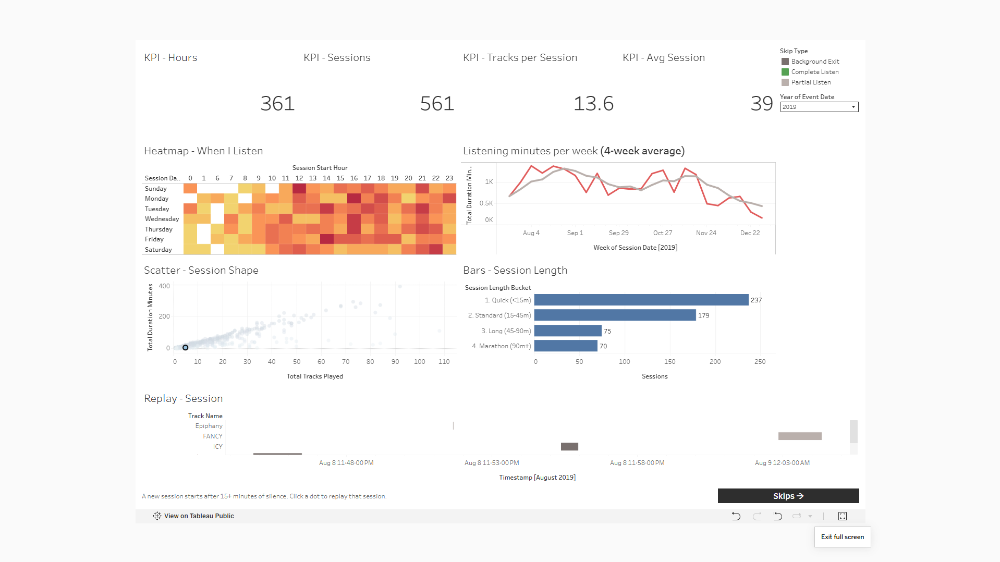
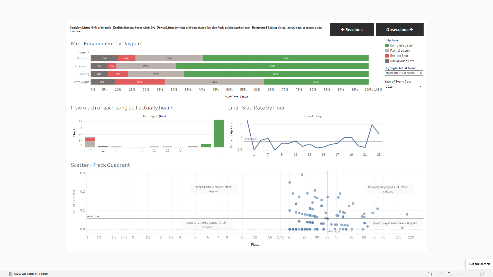
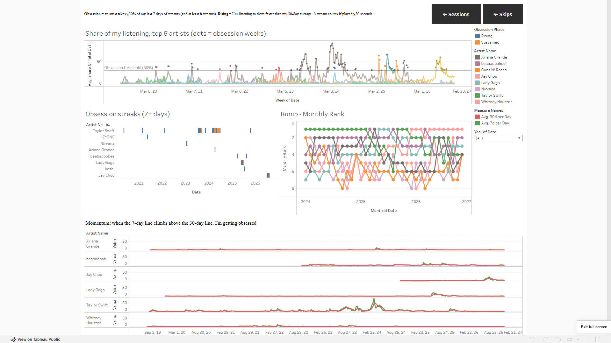

# Spotify Streaming Sessionization & Listener Behavior Engine

   **[View the live dashboard on Tableau Public]https://public.tableau.com/app/profile/miguel.viloria/viz/SpotifyAnalysis_17943827644500/Obsessions**

   
   
   

Turns raw Spotify *Extended Streaming History* JSON into tested, Tableau-ready
data marts covering **listening sessions**, **skip behaviour** and **rolling artist
"obsession" windows**.

**Stack:** Python · DuckDB · dbt (`dbt-duckdb`) · Tableau Public

```
Streaming_History_Audio_*.json ──► stg ──► int (sessionize ► classify) ──► marts ──► CSV ──► Tableau Public
```

---

## Quick start

```bash
pip install -r requirements.txt

make all          # your real export in data/raw/  -> dbt build (44 models/tests) -> CSVs
make synthetic    # no export? generate demo data  -> dbt build -> CSVs
```

**Getting your own data:** Spotify account → Privacy settings → "Download your
data" → tick only *Extended streaming history*. Drop the
`Streaming_History_Audio_*.json` files into `data/raw/` (the `Video` files are
ignored by the glob). `data/raw/` is git-ignored: the export contains IP
addresses. The exported CSVs do not.

No track catalog is needed for real data: the seed only matches the synthetic
URIs, so real tracks fall back to their longest observed full play for duration
and to the artist name for session labels.

---

## Project layout

```
spotify-sessionization-engine/
├── dbt_project.yml                 # project config + all business-rule vars
├── profiles.yml                    # dbt-duckdb connection -> ./spotify_analytics.duckdb
├── Makefile                        # make all | data | build | export | clean
├── requirements.txt
├── data/raw/                       # your Streaming_History_Audio_*.json (git-ignored)
├── data/synthetic/endsong_0.json   # generated demo data
├── seeds/seed_track_catalog.csv    # track duration + genre (not in Spotify logs)
├── macros/generate_schema_name.sql # clean schema names: staging / intermediate / marts
├── models/
│   ├── staging/
│   │   ├── stg_spotify__streams.sql            # read_json_auto, typing, TZ, NULLs, dedup
│   │   ├── stg_spotify__track_catalog.sql
│   │   └── _stg_spotify__models.yml
│   ├── intermediate/
│   │   ├── int_spotify__sessionized_events.sql # LAG + cumulative SUM gaps-and-islands
│   │   ├── int_spotify__skip_classification.sql# Complete / Explicit Skip / Background Exit / Partial
│   │   └── _int_spotify__models.yml
│   └── marts/
│       ├── marts_fct_stream_events.sql         # -> fact_stream_events.csv
│       ├── marts_dim_listening_sessions.sql    # -> dim_listening_sessions.csv
│       ├── marts_listener_obsessions.sql       # -> mart_artist_obsessions.csv
│       └── _marts__models.yml
├── tests/                          # singular tests + 1 dependency-free generic test
├── scripts/
│   ├── generate_synthetic_streams.py
│   └── export_to_tableau.py
└── outputs/                        # Tableau CSVs + _export_manifest.json
```

## DAG

```
seed_track_catalog ─► stg_spotify__track_catalog ─────────────┐
                                                               ▼
raw JSON ──────► stg_spotify__streams ─► int_..._sessionized_events ─► int_..._skip_classification
                                                                                 │
                                                                                 ▼
                                                                    marts_fct_stream_events
                                                                      │                 │
                                                                      ▼                 ▼
                                                     marts_dim_listening_sessions   marts_listener_obsessions
```

Materialisation: staging and intermediate are **views**, marts are **tables**.

---

## Design decisions worth knowing

| Decision | Why |
|---|---|
| **`ts` is the stream END time** | That's how Spotify exports it. Start = `ts - ms_played`. Sessionizing on `ts` alone would mismeasure every gap by the length of a track. |
| **Explicit `columns=` in `read_json_auto()`** | Pins the schema contract: keys missing from older/newer export versions become NULL instead of breaking inference; `union_by_name` handles multi-file drift. |
| **UTC + local timestamps, session TZ pinned to UTC** | Hour-of-day / weekday analysis must be local (default `Asia/Singapore`), and results must not depend on the machine's clock settings. |
| **Dense date spine before rolling windows** | `ROWS BETWEEN 6 PRECEDING` counts *rows*, not days. On sparse data a "7-day" window can silently span weeks. Zero-filling a date × artist grid makes ROWS = DAYS. Tested by `assert_rolling_30d_gte_rolling_7d`. |
| **Track duration from a seed with a fallback** | Spotify logs have no track length, so the 90% rule needs one. If the catalog is missing a track, the longest `trackdone` play is used. `duration_source` records which. |
| **Fourth skip bucket: `Partial Listen`** | The three requested buckets don't cover e.g. a `fwdbtn` at 45s or a `backbtn`. An explicit catch-all keeps the classification exhaustive (enforced by `accepted_values` + `not_null`). |
| **`endplay` counts as a listener action, not a background exit** | In real exports, `endplay` is mostly the listener tapping a different song (median play under 5s). Background Exit is reserved for app/system endings: logout, crashes, remote, errors. |
| **Platform families** | Real exports log raw device strings (`iOS 14.5.1 (iPhone11,8)`, Google Cast partner IDs); staging collapses them into iOS / Android / Windows / macOS / Web Player / Cast. |
| **Obsession grid only for artists with ≥ 100 lifetime streams, starting at first listen** | A full grid of 2,000 artists × 2,700 days would be ~5M mostly-zero rows. Share-of-ear denominators are still computed over *all* artists before filtering. |
| **"Stream" = ≥ 30s played for obsession metrics** | Same threshold Spotify uses for stream counts. Instant skips are not affinity. |
| **Obsession = share + volume; momentum = phase** | Requiring momentum would miss an artist who dominates from day 1 (no baseline to accelerate from). Momentum instead labels the streak `Rising` vs `Sustained`. |
| **All thresholds are dbt vars** | `dbt build --vars '{session_gap_seconds: 1800}'` re-runs the analysis with a 30-minute rule; no SQL edits. |

### Tests (36 data tests + 8 builds, all passing)

Generic tests on keys, enums and relationships, plus singular tests that prove the
business logic:

- `assert_no_intra_session_gap_exceeds_threshold` and `assert_session_starts_follow_long_gaps`
  together prove sessions are **exactly** the islands the 15-minute rule defines.
- `assert_rolling_30d_gte_rolling_7d`: window-frame and date-spine sanity.
- `assert_daily_7d_shares_do_not_exceed_100`: share-of-ear denominators include every artist.
- `assert_session_duration_reconciles`: no minutes lost between fact and dimension.

### Results on a real export (Jul 2019 – Nov 2026)

108,331 raw plays → 364 duplicates removed → **107,967 plays, 9,495 sessions,
5,337 hours**. Engagement mix: 61% Complete Listen, 21% Partial Listen, 10%
Explicit Skip (median 1.4s), 8% Background Exit. The obsession mart covers 157
artists (345k rows) and finds 82 streaks; the longest runs 97 days.
Full build: ~15 seconds.

### Synthetic data results (seed 42)

1,004 raw rows → 4 duplicates removed → **1,000 events in 87 sessions** over 82 days.
The generator plants four "phases" with a favoured artist each; the obsession mart
recovers all four streaks (Neon Harbor → Lumen Ayala → Saffron Circuit → The Velvet
Static) without being told where they are.

---

## Tableau Dashboard Blueprint

**Connect:** Tableau Public → *Text file* → add the three CSVs.

**Data model (logical layer)**

- `fact_stream_events` ── *relationship* `session_id = session_id` ── `dim_listening_sessions` (many-to-one)
- `mart_artist_obsessions` as a **separate data source** (different grain: date × artist).
  Link it to the others with dashboard **filter actions on `artist_name`**, not a join.
  Joining it to events would fan out the rows and inflate every count.

**Canvas:** fixed 1400 × 900, dark background (#121212), one green accent for
"good" (completion) and one warm accent for skips, neutral greys for everything else.

### Tab 1: Executive Summary / Session Breakdown

```
┌──────────┬──────────┬──────────┬──────────┬──────────┐
│ Hours    │ Sessions │ Avg Sess │ Tracks / │ Complet- │   KPI BANs
│ listened │          │ (min)    │ session  │ ion rate │
├──────────┴──────────┴─────────┬┴──────────┴──────────┤
│ When do I listen?             │ Daily listening min  │
│ HEATMAP hour (0-23) × weekday │ BAR + 7d moving avg  │
│ colour = sessions             │ line                 │
├───────────────────────────────┼──────────────────────┤
│ Session shape                 │ Session length       │
│ SCATTER tracks × minutes,     │ BAR by length bucket │
│ colour = completion rate ─────┼─► click = filter     │
├───────────────────────────────┴──────────────────────┤
│ Session replay: GANTT of tracks in the selected      │
│ session (x = timestamp, colour = skip_type)          │
└──────────────────────────────────────────────────────┘
```

| Chart | Source | Build |
|---|---|---|
| KPI BANs | events + sessions | Big numbers, no axes; sub-label with prior-period delta |
| Hour × weekday heatmap | dim | Cols `session_start_hour`, Rows `session_day_of_week` (sort by `MIN(session_day_of_week_num)`), Square marks, colour `CNTD(session_id)` |
| Daily minutes | dim | Bars `SUM(total_duration_minutes)` by `session_date`, dual axis with `WINDOW_AVG(SUM(...), -6, 0)` |
| Session scatter | dim | X `total_tracks_played`, Y `total_duration_minutes`, colour `completion_rate_pct`, detail `session_id` |
| Session replay | events | Gantt: X `timestamp`, size `duration_played_sec / 86400`, rows `track_name`, colour `skip_type`; driven by a filter action from the scatter |

### Tab 2: Skip & Engagement Analytics

```
┌──────────────────────────┬───────────────────────────┐
│ Engagement mix           │ Skip-fatigue curve        │
│ 100% STACKED BAR         │ LINE explicit-skip rate   │
│ skip_type by daypart     │ by position in session    │
├──────────────────────────┼───────────────────────────┤
│ pct_played distribution  │ Skip rate by hour         │
│ HISTOGRAM (10% bins)     │ LINE + avg reference band │
├──────────────────────────┴───────────────────────────┤
│ Track quadrant: SCATTER plays × explicit-skip rate   │
│ ref lines at averages ► Loved / Overplayed / Skipped │
│ / Deep cuts                                          │
└──────────────────────────────────────────────────────┘
```

The **skip-fatigue curve** (skip rate vs `event_seq_in_session`) is the most
interesting chart here, since it shows whether skipping increases as a session goes on.
The **pct_played histogram** should come out bimodal (spikes near 0% and 100%),
which visually justifies the 30s / 90% thresholds.

### Tab 3: Artist Obsession Timeline

```
┌──────────────────────────────────────────────────────┐
│ Share of ear: LINE share_of_total_listens_pct by date │
│ per artist; obsessed days drawn bold (dual-axis       │
│ circles), ref line at the 30% obsession threshold     │
├──────────────────────────────┬───────────────────────┤
│ Obsession streaks            │ Weekly rank           │
│ GANTT: rows = streak id,     │ BUMP CHART rank_7d    │
│ length = streak days, colour │ (reversed axis)       │
│ = obsession_phase            │                       │
├──────────────────────────────┴───────────────────────┤
│ SMALL MULTIPLES per artist: 7d vs 30d rolling streams │
│ (dual axis); hover shows momentum ratio              │
└──────────────────────────────────────────────────────┘
```

Filter `is_full_7d_window = TRUE` on this tab so the first week's warm-up doesn't
show misleading shares. Clicking an artist here filters Tab 2's track quadrant via
a cross-data-source filter action on `artist_name`.

### Calculated fields (Tableau syntax)

```
// Listening Hours
SUM([duration_played_sec]) / 3600

// Completion Rate
AVG(IIF([is_complete_listen], 1, 0))

// Explicit Skip Rate
AVG(IIF([is_explicit_skip], 1, 0))

// Session Position Bucket (for the fatigue curve)
IF [event_seq_in_session] <= 3 THEN "01-03"
ELSEIF [event_seq_in_session] <= 6 THEN "04-06"
ELSEIF [event_seq_in_session] <= 10 THEN "07-10"
ELSE "11+" END

// Streak Start (Gantt)  -- obsessions source
{ FIXED [obsession_streak_id] : MIN([date]) }

// Streak Length (Gantt size)
{ FIXED [obsession_streak_id] : MAX([obsession_streak_length_days]) }

// 7-day Moving Average (table calc, compute along session_date)
WINDOW_AVG(SUM([total_duration_minutes]), -6, 0)
```

### Tableau Public checklist

- Convert each source to an **extract** before publishing (required by Tableau Public).
- Check that `timestamp`, `session_start_ts`, `date` were typed as Date/Date & Time.
- Rename fields to plain English in the data pane (e.g. `7d_rolling_streams` → "Streams (7d)").
- Sort every weekday axis by the `*_day_of_week_num` field.
- Add a "How sessions are defined" text box: *a new session starts after 15+ minutes of silence.*
